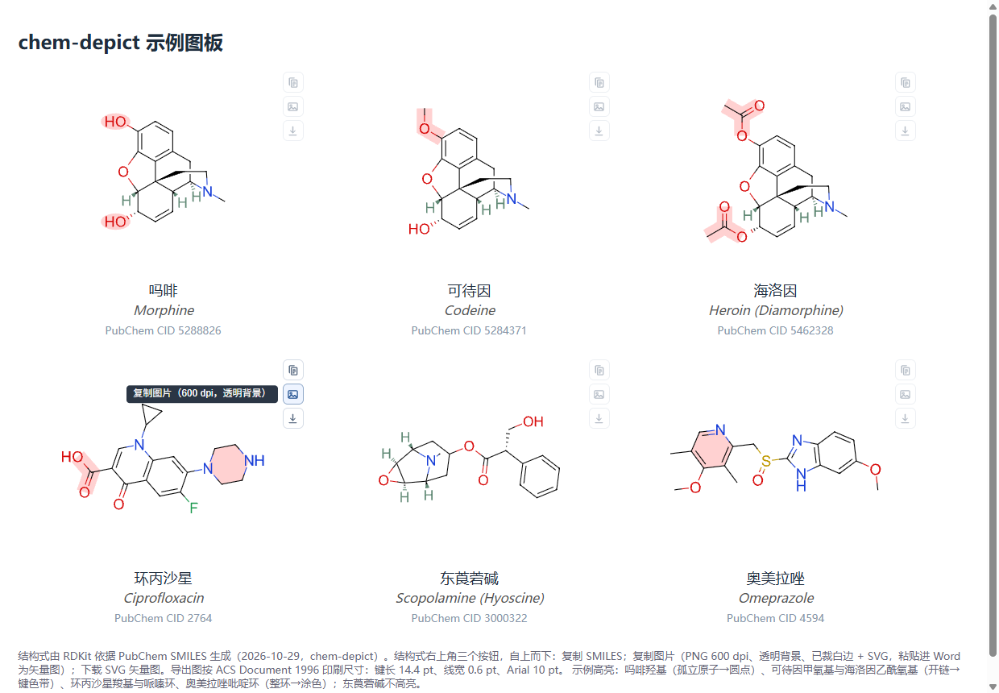

# chem-depict · 药物化学结构式图板

由 SMILES（或药名）生成**统一画风**的药物化学结构式 HTML 图板，供课件、测验、讲义、汇报材料使用。可作为 [Claude Code](https://code.claude.com) 插件（skill）使用，也可当普通 Python 库调用。

*Generate consistent, ACS-style medicinal-chemistry structure boards (HTML) from SMILES. Each structure card offers one-click copy of the SMILES, a 600-dpi transparent image, or an SVG vector that pastes into Word as a true vector graphic. Works as a Claude Code plugin or a plain Python library (RDKit-based).*



在线示例：打开 [`examples/example_board.html`](examples/example_board.html)（下载后用浏览器打开即可体验按钮）。

## 特点

- **ACS Document 1996 规格**：导出时键长 14.4 pt、线宽 0.6 pt、Arial 10 pt、双键间距 18%，交叉键两侧留白 1.6 pt。
- **排版好看**：默认用 RDKit 环系模板；吗啡烷类（吗啡、可待因、海洛因……）内置经典教材朝向；同组对比的分子共用骨架坐标，朝向一致。
- **交叉键自动断开**：被压在下方的键在交叉处真正剪断，透明背景下也不露白。
- **只标关键氢**：只在桥头 / 稠环立体中心等楔形键表达不了构型的位置标 H，另可指定教学上要强调的 H。
- **教学高亮**：按考点指定高亮部位（原子或 SMARTS）；整环涂色，开链画键色带，孤立原子画圆点。
- **元素习惯色**：O 红、N 蓝、S 暗黄、卤素绿、H 灰绿。
- **一键导出**：每个结构右上角三个图标按钮——复制 SMILES / 复制图片（PNG 600 dpi + SVG，透明背景、已裁白边）/ 下载 SVG。粘贴进 Word 得到的是矢量图，物理尺寸即 ACS 印刷尺寸。
- **质量检查**：出图前检查原子是否重叠（近接检查），避免「看着像连错了键」。

## 安装

先装 Python 依赖（Python 3.9+）：

```bash
pip install -r requirements.txt      # rdkit、pymupdf、pillow
```

### 作为 Claude Code 插件

```bash
claude plugin marketplace add lotuseeds/chem-depict
claude plugin install chem-depict@lotuseeds
```

在 Claude Code 会话中也可以用 `/plugin marketplace add lotuseeds/chem-depict`，再在 `/plugin` 面板中安装。装好后对 Claude 说「把吗啡、海洛因画成结构式图板」「用这个 SMILES 画个结构式」即可。

不想用插件市场的话，也可以把 `plugins/chem-depict/skills/chem-depict/` 整个文件夹复制到 `~/.claude/skills/` 下。

### 作为 Python 库

```python
import sys; sys.path.insert(0, "plugins/chem-depict/skills/chem-depict/scripts")
import chemstyle as cs

smi = "CN1CC[C@]23[C@@H]4[C@H]1CC5=C2C(=C(C=C5)O)O[C@H]3[C@H](C=C4)O"   # 吗啡
m = cs.layout(smi, template="morphinan_classic")
assert not cs.close_contacts(m)                      # 原子无重叠
svg = cs.draw(m, highlight=cs.hits(m, "[OX2H]"))     # 高亮两个羟基
html = cs.board("示例", [cs.mol_card(svg, "吗啡", "Morphine", smi, 5288826)])
open("board.html", "w", encoding="utf-8").write(html)
```

主要函数：`layout`（排版）、`draw`（出 SVG）、`close_contacts`（近接检查）、`hits`（SMARTS 取原子）、`export_svg` / `to_png`（ACS 尺寸透明导出）、`mol_card` / `board`（生成图板）。示例图板的生成脚本见 [`examples/make_example.py`](examples/make_example.py)。

## 目录结构

```
.claude-plugin/marketplace.json        插件市场清单
plugins/chem-depict/
  .claude-plugin/plugin.json           插件信息
  skills/chem-depict/
    SKILL.md                           给 Claude 的使用说明
    scripts/chemstyle.py               绘图、导出、图板
    scripts/card.js                    网页按钮交互
    templates/butylscopolamine.mol     托品烷季铵盐手工坐标示例
examples/                              示例图板与生成脚本
```

## 说明

- 字体：Windows / macOS 上使用系统 Arial；找不到 Arial 时改用 RDKit 内置字体，图照常生成。
- 「复制图片」需要 Chromium 内核浏览器（Chrome / Edge）；不支持写剪贴板时自动改为下载 PNG。
- SMILES 默认取自 [PubChem](https://pubchem.ncbi.nlm.nih.gov/)。未发表的化合物请只在本地使用，不要发送到在线服务。
- 颜色方案（元素色、浅红高亮）是为教学有意设置的，偏离 ACS 1996 的黑白默认。

## 作者与许可

作者：廉明明（Lian Mingming），哈尔滨医科大学大庆校区药学院（School of Pharmacy, Harbin Medical University-Daqing）

许可：[MIT](LICENSE)

致谢：结构式绘制基于 [RDKit](https://www.rdkit.org/)（BSD 许可），化合物数据来自 [PubChem](https://pubchem.ncbi.nlm.nih.gov/)。
